<div align="center">

# 🛡️ NetSentry XAI

### Explainable AI for Network Forensics & Threat Investigation

**From raw packets to an evidence-backed, explainable investigation — entirely in your browser.**


[✨ Features](#-features) •
[🚀 Quick Start](#-quick-start) •
[🏗️ Architecture](#️-architecture) •
[🔍 Detection](#-detection-engine) •
[🧠 Explainability](#-explainability-by-design) •
[☁️ Deploy](#️-deploy-to-netlify)

</div>

---

## 📖 What is NetSentry XAI?

NetSentry XAI turns **PCAP / PCAPNG packet captures** into an understandable investigation: *what happened, which hosts and flows were involved, why each event was flagged, how unusual it was, and what evidence supports it.*

Unlike black-box classifiers, every finding is **traceable back to packets, flows and timestamps**, and every score comes with a plain explanation, alternative explanations and known limitations.

> [!IMPORTANT]
> **No backend. No uploads. No telemetry.** The whole analysis engine runs in a Web Worker inside your browser. Captures stay on your machine, stored only in your browser's IndexedDB.

<table>
<tr>
<td width="33%" valign="top">

### 📦 Evidence first
Every alert links to packet indices, flow IDs, timestamps, observed values and the thresholds that fired.

</td>
<td width="33%" valign="top">

### 🔎 Explainable by default
Observed facts, detection rationale and interpretation are always kept separate, so a narrative is never mistaken for evidence.

</td>
<td width="33%" valign="top">

### 🧑‍💼 Human-led
Read-only analysis. Analysts review, annotate, escalate or dismiss findings, and every action is audited.

</td>
</tr>
</table>

---

## ✨ Features

| | Feature | What you get |
|:-:|---|---|
| 📥 | **PCAP & PCAPNG upload** | Drag-and-drop, multiple files, magic-byte validation, size limits, SHA-256 chain of custody |
| 🧬 | **Protocol dissection** | Ethernet/VLAN/SLL, IPv4/IPv6, TCP/UDP/ICMP, DNS, HTTP, SSH, QUIC, TLS with **SNI, ALPN, JA3/JA3S** |
| 🔀 | **Flow reconstruction** | Bidirectional 5-tuple flows, idle-timeout splitting, Zeek-style connection states |
| 🎯 | **14 transparent rules** | Scans, sweeps, beaconing, DNS tunnelling, floods, exfiltration, ARP spoofing, lateral movement and more |
| 📊 | **Statistical baseline** | Robust median/MAD z-scores for unusual host egress |
| 🌲 | **Isolation Forest** | Seeded, reproducible anomaly scoring with per-feature attribution |
| 🧠 | **Structured explanations** | Facts → rationale → interpretation → alternatives → next checks → limitations |
| 🧩 | **Incident correlation** | Findings grouped by shared hosts and time; analysts can split or merge groupings |
| ⚖️ | **Transparent risk priority** | Weighted, configurable score, with every component shown |
| 🕸️ | **Host network graph** | Interactive force-directed graph with severity rings, drag, zoom and pan |
| 🕒 | **Incident timeline** | Swim-lane timeline with incident windows and zoom |
| 💬 | **Evidence assistant** | Ask *"What did 10.10.0.23 do?"* and get answers with clickable citations (no external AI) |
| 🆚 | **PCAP Diff** | Compare two captures: new hosts, domains, SNI, JA3, ports and protocol shifts |
| 🧪 | **Evaluation lab** | Live precision / recall / F1 for rules-only vs anomaly-only vs hybrid |
| 🗺️ | **MITRE ATT&CK** | Technique mapping, presented as a hypothesis rather than attribution |
| 📄 | **Reports** | PDF, HTML, JSON, CSV and **STIX 2.1** with provenance, configuration and audit trail |

---

## 🚀 Quick Start

```bash
# 1. Install dependencies (Node 18+, Node 20 recommended)
npm install

# 2. Start the dev server → http://localhost:5173
npm run dev

# 3. Production build → dist/
npm run build && npm run preview
```

Then open the site and click **"Run the live demo"**, or go to **PCAP Ingestion** and drop in your own capture.

### 🧭 First-run journey

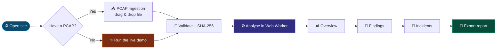

---

## 🏗️ Architecture

NetSentry XAI is a **static single-page app**. The Python/FastAPI pipeline from the original blueprint has been ported to TypeScript and runs in a background Web Worker, so the UI stays responsive and no server is needed.

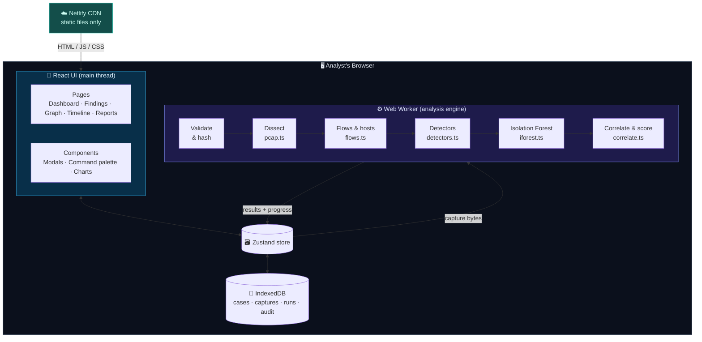

> [!NOTE]
> The only network traffic is downloading the site itself from Netlify (plus optional Google Fonts). Capture data never crosses the network.

### 🔄 Analysis pipeline, step by step

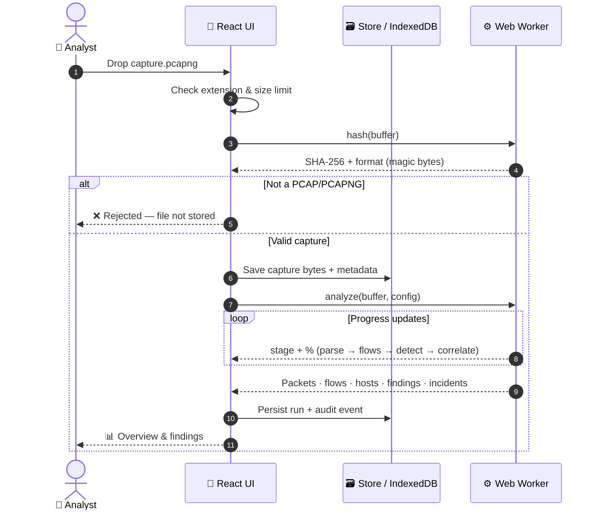

---

## 🔬 How a capture becomes findings

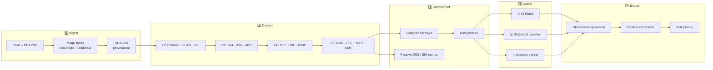

### 🔀 Flow reconstruction & connection states

Packets are grouped into **bidirectional flows** using a canonical 5-tuple (`proto : endpointA <-> endpointB`). A new flow starts after the idle timeout (default 120 s) or when a fresh SYN reuses a closed port pair. TCP flows get a Zeek-style state:

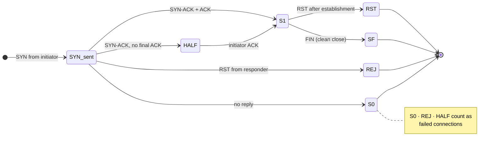

---

## 🔍 Detection Engine

Detection is **layered**: transparent rules first, then statistical baselines, then an unsupervised model. Each layer's signal is kept separate, and each layer can be switched off in **Detection Settings**.

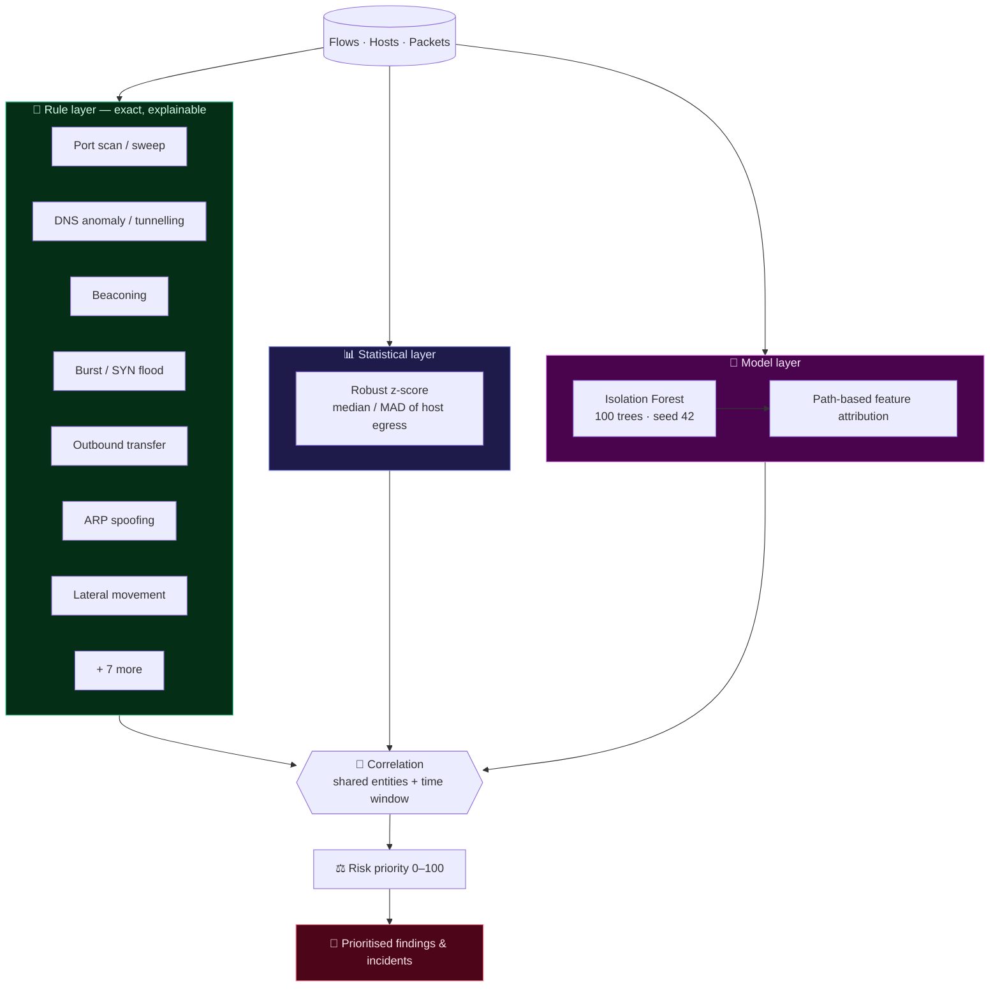

### 📋 Detector catalogue

| Detector | Layer | Looks for | ATT&CK (hypothesis) |
|---|:-:|---|:-:|
| `rule_port_scan` | 🎯 | Many ports on one host (sliding window) or one port on many hosts | T1046 |
| `rule_failed_connections` | 🎯 | Many S0 / REJ / half-open attempts from one source | T1046, T1110 |
| `rule_icmp_sweep` | 🎯 | Echo requests to many hosts | T1018 |
| `rule_dns_anomaly` | 🎯 | NXDOMAIN ratio, long / high-entropy labels, unique-subdomain bursts | T1071.004, T1568.002, T1048 |
| `rule_beacon_periodicity` | 🎯 | Low-jitter repeated connections (bulk transfers excluded from timing) | T1071.001, T1041 |
| `rule_traffic_burst` | 🎯 | Packets-per-second bursts; SYN-dominated → possible flood | T1498, T1499 |
| `rule_outbound_transfer` | 🎯 | Large internal → external egress per destination | T1048, T1041 |
| `rule_tcp_flag_anomaly` | 🎯 | SYN+FIN, Xmas, NULL flag packets | T1046 |
| `rule_protocol_port_mismatch` | 🎯 | TLS / HTTP / SSH / DNS on unexpected ports | T1571, T1572 |
| `rule_cleartext_credentials` | 🎯 | HTTP Basic, FTP / POP3 / IMAP / SMTP auth, Telnet (values never stored) | T1040 |
| `rule_arp_spoofing` | 🎯 | One IP claimed by several MACs; unsolicited ARP storms | T1557.002 |
| `rule_lateral_movement` | 🎯 | Internal fan-out on SMB / RDP / SSH / WinRM / RPC | T1021 |
| `rule_fan_in` | 🎯 | Many sources converging on one destination | T1498 |
| `rule_suspicious_port` | 🎯 | Answered sessions to backdoor / IRC / Tor ports | T1571 |
| `stat_host_volume_outlier` | 📊 | Host egress far above the capture's median host | — |
| `ml_isolation_forest_flow` | 🌲 | Flows the Isolation Forest isolates unusually fast | — |

> [!WARNING]
> Every detector documents its **blind spots** (for example, legitimate vulnerability scanners resemble port scans, and NTP is periodic by design). These caveats appear in the UI, in every finding and in every report.

---

## 🧠 Explainability by Design

Each finding separates **what the capture shows**, **why it fired** and **what it might mean**:

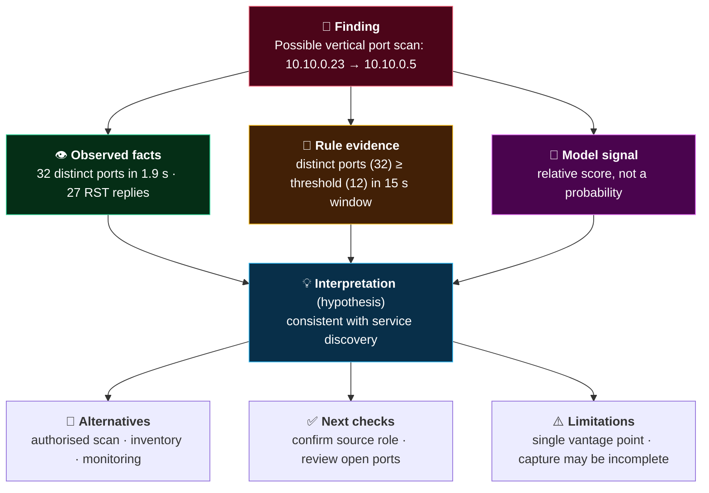

### ⚖️ Risk priority formula

```
Priority = 100 × (w₁·Severity + w₂·Anomaly + w₃·Evidence + w₄·Corroboration + w₅·Context) / Σw
```

| Component | Meaning | Default weight |
|---|---|:-:|
| **Severity** | Potential impact if the hypothesis is true | 0.35 |
| **Anomaly** | How unusual the related flows are (model / statistical) | 0.15 |
| **Evidence** | How many packets and flows support the claim, and how complete they are | 0.20 |
| **Corroboration** | Independent detectors in the same incident | 0.20 |
| **Context** | Critical asset → internal host → external host | 0.10 |

> Priority is a **ranking aid, not a calibrated probability**. Weights are editable, and every component is shown next to the score.

### 🧩 Incident correlation

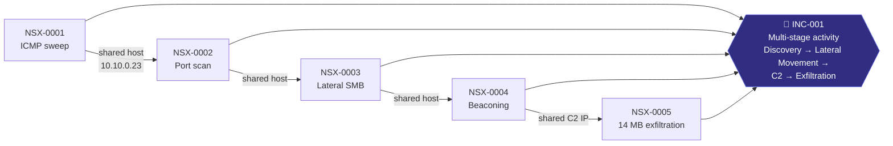

Findings are grouped with **union-find** when they share an entity within the correlation window (default 30 min). Each incident shows **why** it was grouped, and analysts can **split or merge** incidents, with every change logged.

### 🔁 Finding lifecycle (analyst triage)

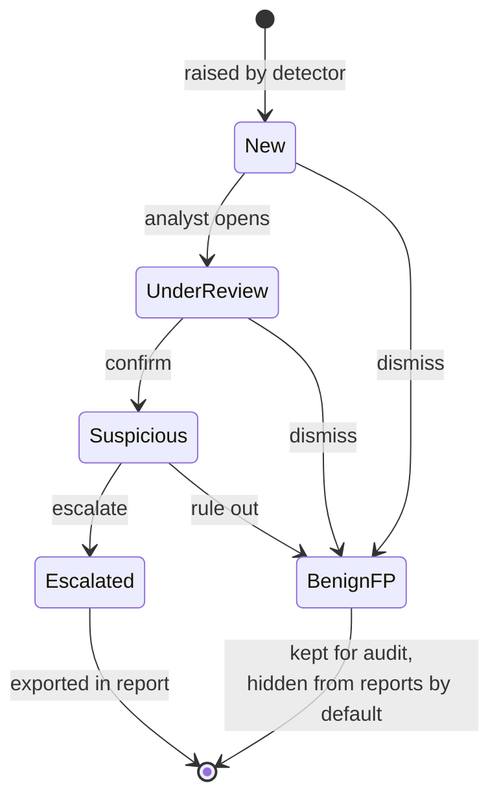

> Dispositions **carry forward** when you re-run the analysis with new settings.

---

## 🗺️ The Workspace

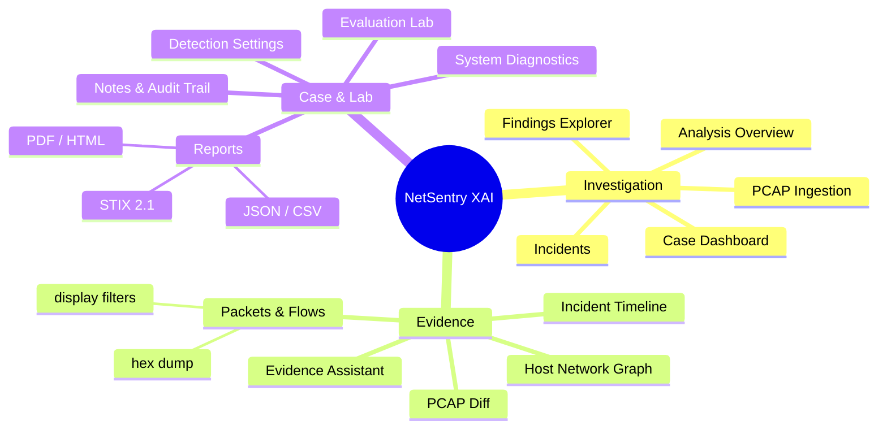

**Power-user extras:** `Ctrl/⌘ + K` command palette · saved filters · bulk triage · display filters such as `ip:10.0.0.5 port:443 proto:tls state:S0` · case bundle export/import.

---

## 🧪 Demo Captures & Evaluation

All demo traffic in `public/samples/` is **synthetic** and labelled as such.

| Capture | Type | What's inside |
|---|:-:|---|
| `enterprise_multistage_intrusion.pcap` | 🔴 | 15-minute office capture: drive-by download, TLS beaconing, ICMP sweep, port scan, SMB lateral movement, DNS tunnelling, 14 MB exfiltration, ARP spoofing, Xmas probes, cleartext FTP & Telnet |
| `office_baseline_benign.pcapng` | 🟢 | Benign office traffic in PCAPNG format with IPv6, used as a baseline for PCAP Diff |
| `port_scan_recon.pcap` | 🔴 | Vertical SYN scan across 25 ports |
| `dns_tunneling_anomaly.pcap` | 🔴 | High-entropy DNS labels with NXDOMAIN replies |
| `c2_beaconing.pcap` | 🔴 | Six heartbeats exactly 2 s apart |
| `syn_flood_burst.pcap` | 🔴 | 260 SYNs to one host in one second |
| `benign_web_browsing.pcap` | 🟢 | One DNS lookup and an HTTP fetch |

Regenerate the synthetic captures with `npm run samples`.

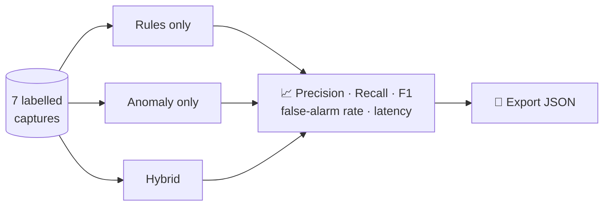

The **Evaluation Lab** runs these scenarios live in your browser. On the bundled synthetic set, rules-only and hybrid modes fire every expected detector with no unexpected rule alerts, and anomaly-only mode is noticeably noisier. These are synthetic results: run your own labelled captures before drawing real-world conclusions.

---

## ☁️ Deploy to Netlify

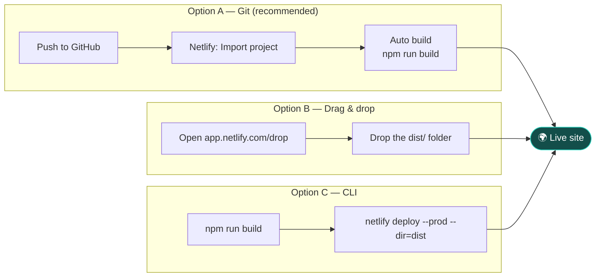

Everything is pre-configured in **`netlify.toml`**:

| Setting | Value |
|---|---|
| Build command | `npm run build` |
| Publish directory | `dist` |
| Node version | 20 |
| SPA routing | `/* → /index.html (200)` |
| Security headers | CSP, `X-Frame-Options: DENY`, `nosniff`, `Referrer-Policy`, `Permissions-Policy` |

```bash
# CLI deploy
npm install
npm run build
npx netlify-cli deploy --prod --dir=dist
```

---

## 📁 Project Structure

```
netsentry-xai/
├── 📄 netlify.toml              # Build, SPA redirect, security headers
├── 📄 package.json
├── 📂 public/
│   ├── favicon.svg
│   ├── _redirects
│   └── 📂 samples/              # Synthetic demo captures
├── 📂 scripts/
│   └── generate-samples.mjs     # Synthetic PCAP/PCAPNG generator
└── 📂 src/
    ├── 📂 engine/               # ⚙️ Analysis engine (runs in Web Worker)
    │   ├── pcap.ts              #    PCAP/PCAPNG reader + protocol dissectors
    │   ├── flows.ts             #    Flow reconstruction, host profiles, passive DNS
    │   ├── detectors.ts         #    14 rules + statistical + Isolation Forest wrapper
    │   ├── iforest.ts           #    Seeded Isolation Forest + attribution
    │   ├── correlate.ts         #    Incident correlation + risk scoring
    │   ├── pipeline.ts          #    End-to-end orchestration + summary
    │   ├── worker.ts            #    Web Worker entry (hash + analyse)
    │   ├── config.ts            #    Default thresholds & weights
    │   └── types.ts             #    Shared data contracts
    ├── 📂 store/                # 🗃️ Zustand state + IndexedDB persistence
    ├── 📂 lib/                  # 🧰 Reports, assistant, diff, formatting, samples
    ├── 📂 components/           # 🎨 Shell, modals, command palette, UI kit
    └── 📂 pages/                # 📄 Landing + 15 workspace pages
```

---

## 🛠️ Tech Stack

| Layer | Technology |
|---|---|
| UI | React 18 · TypeScript 5 · Vite 5 · Tailwind CSS 3 |
| State & storage | Zustand · IndexedDB (fallback to memory) |
| Charts & graph | Recharts · d3-force |
| Icons | Lucide |
| Analysis | Custom TypeScript dissectors · Isolation Forest · WebCrypto SHA-256 |
| Concurrency | Web Worker (ES module) |
| Hosting | Netlify (static) |

---

## 🔒 Security & Privacy

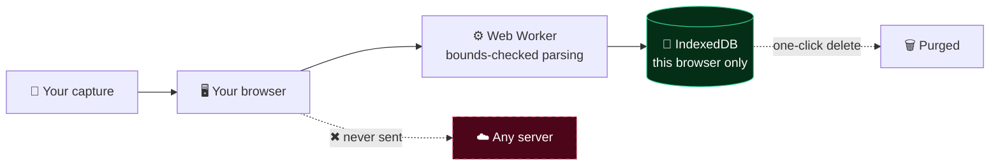

- ✅ **Local-first:** no backend, no telemetry, no third-party enrichment
- ✅ **Untrusted-input handling:** bounds-checked parsing, size and packet limits; malformed packets are recorded, not dropped
- ✅ **Chain of custody:** SHA-256 on every capture; config hash and engine versions on every run
- ✅ **Credentials never stored:** cleartext logins are flagged with their values redacted
- ✅ **Read-only:** never blocks traffic or changes infrastructure
- ✅ **Retention control:** delete per capture or per case, or purge everything from *System Diagnostics*
- ✅ **Strict CSP** and security headers via `netlify.toml`

---

## 📌 Honest-Uncertainty Principles

> [!CAUTION]
> - Scores are **relative indicators**, not probabilities of compromise.
> - **Evidence confidence** is reported separately from **severity**.
> - ATT&CK mappings are **hypotheses**, never attribution.
> - **Absence of a finding does not prove absence of activity**: captures can be incomplete or encrypted.
> - Analyse only traffic you are **authorised** to inspect.

---

<div align="center">

**NetSentry XAI** — *the strength is not the number of AI features, it is the link between every AI-assisted claim and concrete network evidence.*

⭐ If this project helped you, consider starring the repository.

</div>
